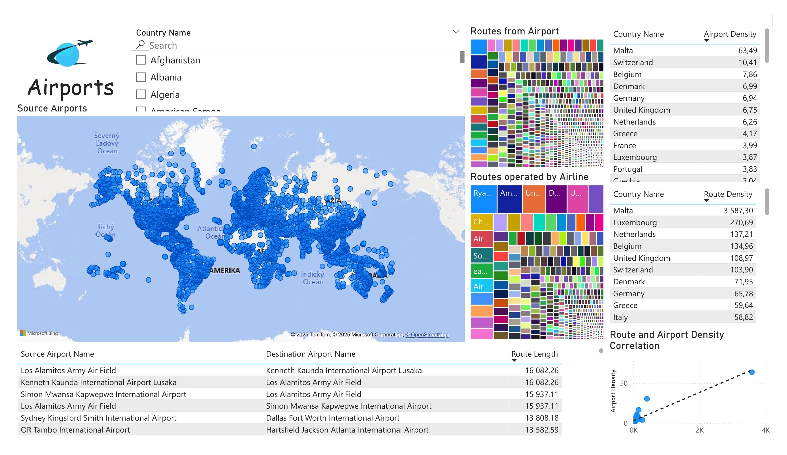
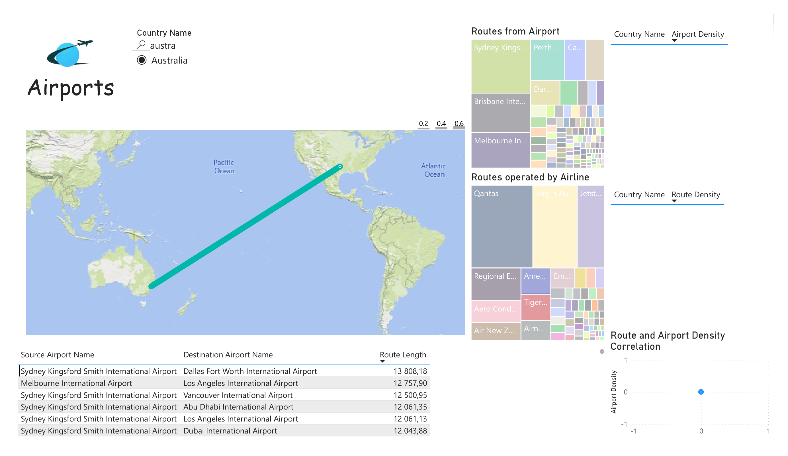

# EDW
Data warehouse practice project

The project revolves around plane and airport data.
Tech used: Pentaho, PowerBI, PostgreSQL, Excel, ER modeler, text files and loads of patience

## Final PowerBI connected to the DB

